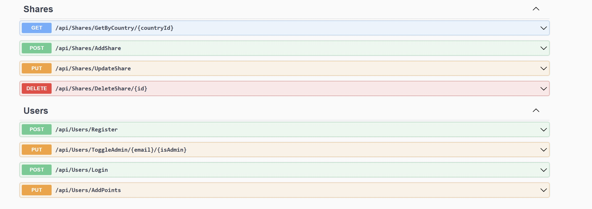
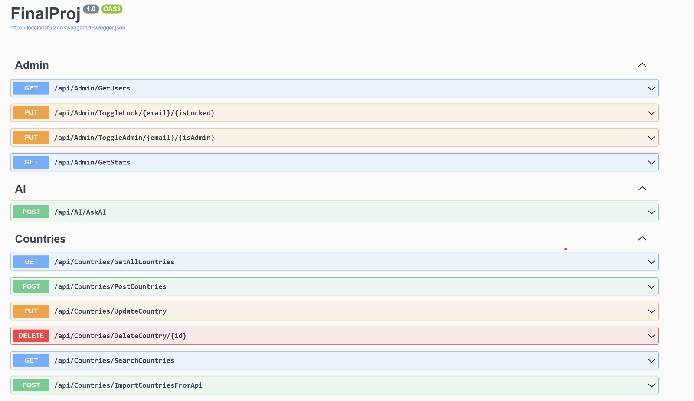

# WorldExplorer – Server (ASP.NET Core Web API)

Backend for **WorldExplorer**, a full-stack web platform for exploring countries around the world. The API handles country data, user accounts and sessions, user-generated content, quizzes with leaderboards, an admin panel, and an AI-powered trip planner.

> Built as a pair project at Ruppin Academic Center. Client repository: [Client-Final-](https://github.com/TalVaizbord/Client-Final-)

## Live Demo

**[Open the live site](https://proj.ruppin.ac.il/cgroup29/test2/tar2/Pages/index.html)**

Demo account (regular user, no admin rights):

- Email: `123@gmail.com`
- Password: `122112`

## Screenshots

### API documentation (Swagger)



## Features

- **Countries** – import world-country data from a public API into SQL Server, full CRUD, and multi-criteria search (name, region, language, currency, minimum population, minimum area). Results are cached in memory with thread-safe (double-checked) locking for fast loading.
- **Users & authentication** – registration, login/logout, session-based authentication (HTTP-only cookie, 60-minute idle timeout), profile updates, and login logging.
- **Personal lists** – each user's saved country lists (favorites, travel destinations, visited) are stored in the database and synced across sessions.
- **Community comments** – create, read, update and delete comments per country.
- **Quizzes** – points and high-score tracking per quiz type, with a top-10 leaderboard.
- **Admin panel** – lock/unlock users, grant/revoke admin rights, and view usage statistics.
- **AI trip planner** – forwards user requests to the Google generative AI API from the server, so the API key is never exposed to the browser.

## Tech Stack

| Area | Technology |
|---|---|
| Language / Framework | C#, ASP.NET Core Web API (.NET 6) |
| Database | Microsoft SQL Server, ADO.NET (`System.Data.SqlClient`), stored procedures |
| API documentation | Swagger / Swashbuckle |
| Auth | Server-side sessions |
| External APIs | Public countries API, Google generative AI API |

## Project Structure

```
TT_Proj_Server/
├── Controllers/   # REST endpoints: Countries, Users, Shares, Admin, AI
├── Models/        # Country, User, Share
├── DAL/           # DBServices – all database access via stored procedures
└── Program.cs     # Services, session, CORS, Swagger
```

## API Overview (25 endpoints)

| Controller | Endpoints |
|---|---|
| `Countries` | GetAllCountries, SearchCountries, PostCountries, UpdateCountry, DeleteCountry, ImportCountriesFromApi |
| `Users` | Register, Login, Logout, CheckSession, UpdateProfile, AddPoints, UpdateHighScore, GetLeaderboard, GetUserLists, SaveUserLists |
| `Shares` | GetByCountry, AddShare, UpdateShare, DeleteShare |
| `Admin` | GetUsers, ToggleLock, ToggleAdmin, GetStats |
| `AI` | AskAI |

## Getting Started

**Prerequisites:** .NET 6 SDK, SQL Server, and a Google generative AI API key.

1. Clone the repository and open `TT_Proj_Server.sln` in Visual Studio.
2. Create an `appsettings.json` in the project folder with your own values:
   ```json
   {
     "ConnectionStrings": { "RuppinDB": "<your SQL Server connection string>" },
     "GoogleSettings": { "ApiKey": "<your API key>", "ApiUrl": "<generative AI endpoint URL>" }
   }
   ```
3. Create the database tables and stored procedures that the data-access layer calls (`SP_*_TT`). The SQL scripts are not included in this repository.
4. Run the project and open Swagger at `https://localhost:7234/swagger`.
5. Call `POST /api/Countries/ImportCountriesFromApi` once to populate the countries table.

Never commit real API keys or connection strings.
